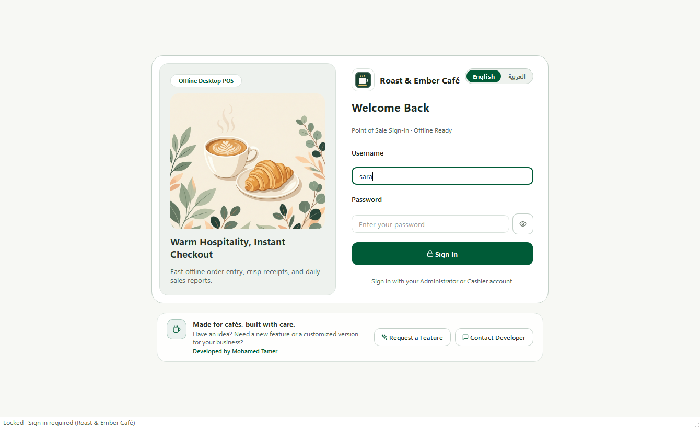
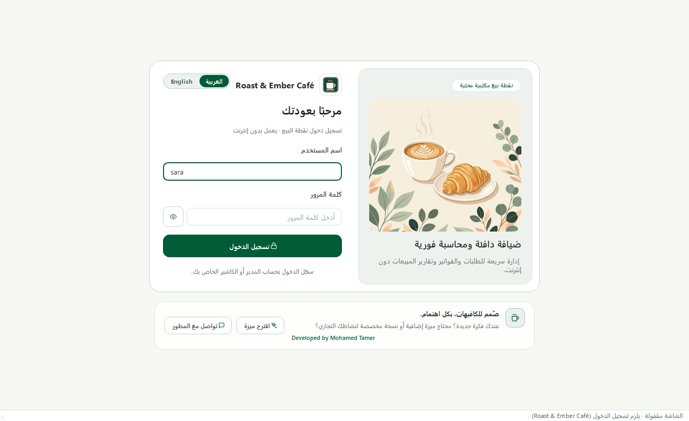
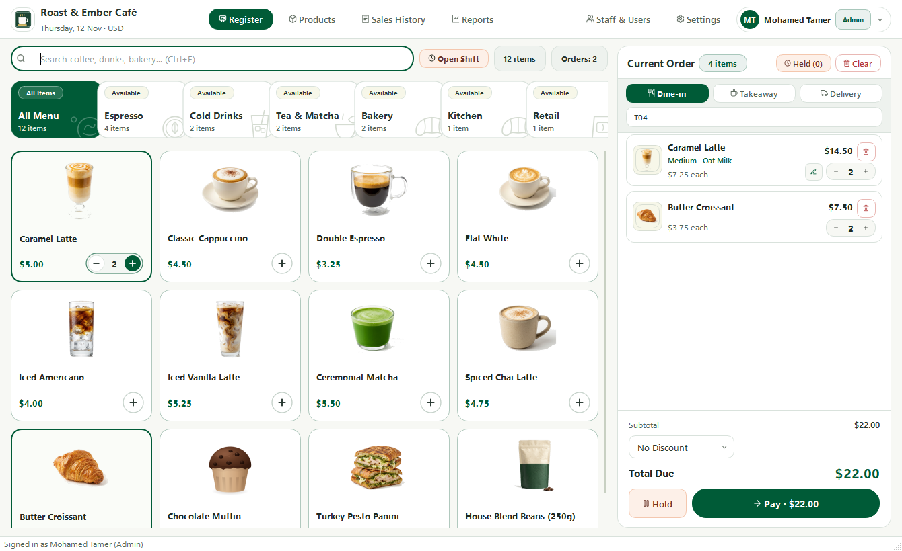
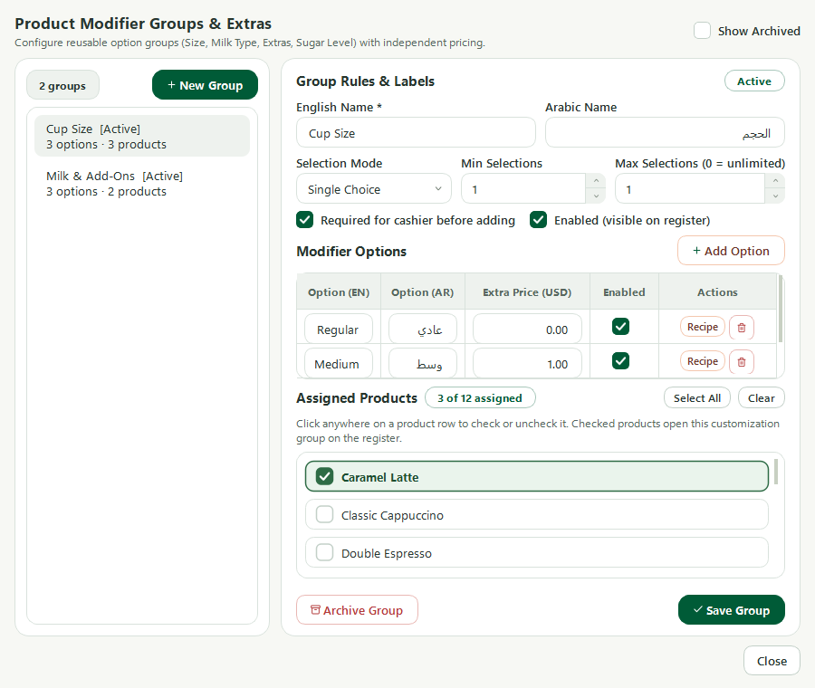
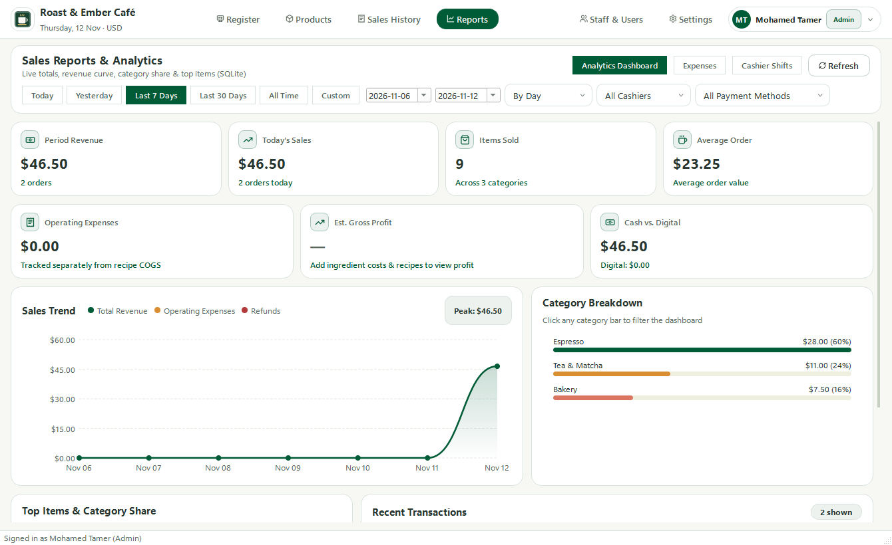
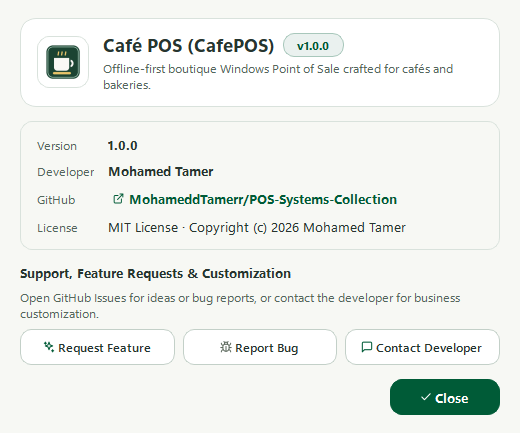

# Café POS v1.0.0 — Windows Desktop Point of Sale

An independent, **offline-first**, **white-label** Windows desktop Point of Sale (POS) application built for cafés, specialty coffee bars, bakeries, and tea shops. Designed around a calm **Boutique Café** native interface using **Python 3**, **PySide6 (Qt Widgets)**, **Pillow**, **Argon2id (`argon2-cffi`)**, and **SQLite**, and packaged into a standalone **`CafePOS-v1.0.0-Windows.exe`** executable with **PyInstaller**.

No web browser, no cloud subscription, no local web server, and no Python installation are required for end users running the Windows executable.

**Developed by [Mohamed Tamer](https://github.com/MohameddTamerr)** · **Version:** `1.0.0` · **Release Tag:** `cafe-pos-v1.0.0`

---

## Windows Screenshots

### Sign-In & Bilingual Arabic RTL
| English (LTR) | Egyptian Arabic (RTL) |
| --- | --- |
|  |  |

### Cashier Register, Product Modifiers & Analytics
| Boutique Cashier Register (`F1`) | Modifiers & Extras Manager |
| --- | --- |
|  |  |

| Sales Analytics, Expenses & Shifts (`F4`) | Help & About |
| --- | --- |
|  |  |

---

## System Requirements (Windows)

- **Operating System:** Windows 10 or Windows 11 (64-bit recommended)
- **Runtime Prerequisites (End Users):** None — standalone single-file executable (`CafePOS-v1.0.0-Windows.exe`)
- **Storage:** Writable `%LOCALAPPDATA%\MohamedTamer\CafePOS` directory
- **Printing (Optional):** Any Windows-configured thermal (58mm / 80mm) or standard printer, plus built-in A5 PDF export

---

## End-User Installation

1. Download **`CafePOS-v1.0.0-Windows.exe`** from the [`cafe-pos-v1.0.0` GitHub Release](https://github.com/MohameddTamerr/POS-Systems-Collection/releases).
2. Double-click **`CafePOS-v1.0.0-Windows.exe`** to start (if Windows SmartScreen prompts on an unsigned open-source binary, choose **More info → Run anyway**).
3. Complete the two-step first-launch setup wizard:
   - Configure storefront identity, currency, language, accent color, and optional logo.
   - Create the primary **Administrator** account (no default or hardcoded passwords exist).
4. Begin ringing up orders immediately—12 starter café products with bundled studio photography are pre-seeded and ready for testing or editing.

---

## Implemented Features (`v1.0.0`)

### Cashier Register, Modifiers & Order Workflow (`F1`)
- **Boutique Category Strip & Studio Product Cards:** Scrollable category cards with item counts and vector line art, studio product cutouts, dynamic `[ - ] N [ + ]` quantity steppers synchronized bidirectionally with the cart, keyboard quantity control, and instant search (`Ctrl+F`).
- **Product Modifiers & Extras:** Configure reusable bilingual modifier groups (such as Size, Milk Type, Sugar Level, Extras) with independent pricing, single-select or multi-select rules, required/optional flags, min/max selection limits, and per-option ingredient recipes. Clicking a customizable product opens a live price-updating customization modal, identical items with different selections are separated in the cart, cart line modifiers can be edited inline, and historical orders preserve sale-time modifier snapshots.
- **Order Types & Held Orders:** Switch between **Dine-in** (table number), **Takeaway**, and **Delivery** (customer name, phone, delivery address), attach order notes, park unpaid carts using **Hold**, and resume or cancel held orders cleanly at any time.
- **Discounts, Split Payments & Fast Checkout (`F12`):** Apply percentage or fixed-amount order discounts (with optional Admin-enforced Cashier discount caps), accept **Cash** (with quick-cash buttons and change due), **Card**, digital/custom enabled payment methods, or **Split Payments** across multiple methods using exact integer minor-unit math.
- **Cashier Shifts & Drawer Reconciliation:** Open/close cashier shifts with optional opening cash float enforcement, record drawer cash-in/paid-out movements, calculate expected cash vs. counted drawer cash discrepancy, and review shift summaries.

### Bilingual English & Egyptian Arabic with Full RTL (`en` & `ar-EG`)
- **Live Switching Without Restart:** Switch between **English (LTR)** and **العربية (`ar-EG`, RTL)** from the Setup Wizard, Sign-In screen, Settings, or Top Bar profile menu without losing active cart lines, inputs, or current session state.
- **True RTL Mirroring & Bidi Safety:** Automatically mirrors header navigation, category cards, quantity steppers, cart rows, tables, charts, receipts, and dialogs; supports Arabic-Indic numeral input (`١٢٥٫٥٠`), Arabic pluralization, and localized currency formatting (`EGP` `ج.م`, `SAR` `ر.س`, `AED` `د.إ`, `USD`, `EUR`, `GBP`, `CAD`, `AUD`, `JPY`).
- **Personal Display Preferences:** Any signed-in Admin or Cashier can adjust personal font scale (`85%–140%`), layout density (`Comfortable` / `Compact`), preferred UI language, and **Reduced Motion** settings from the user profile menu.

### Products, Categories, Recipes & Ingredient Inventory (`F2` — Admin)
- **Catalog, Bilingual Categories & Modifiers:** Create, edit, archive, and manage products, categories (via editable category selector), and reusable modifier groups (`Modifiers...`).
- **Smart Local & Online Product Photo Helper:** Upload local PNG/JPG/WebP/BMP files, apply square Fill/Fit/Zoom framing, remove backgrounds (`Cutout BG`), or search stock photos online via **Openverse (no API key)** or optional user-supplied **Pexels** key; confirmed photos are cached locally inside `product_images/`.
- **Ingredient Inventory & Recipe Auto-Deduction:** Track ingredient stock quantities, units, cost per unit, and low-stock alert thresholds; link recipes to products and modifier options; inspect live low-stock badges on the Register; and automatically deduct ingredient stock on checkout (with configurable refund stock restoration).

### Sales History, Refunds & Windows Thermal/PDF Receipts (`F3`)
- **Scoped Ledger & Order Refunds:** Cashiers view their own completed sales while Administrators inspect all transactions across cashiers, dates, payment methods, and order types. Supports partial or full order refunds with reason logging and optional inventory restocking.
- **Receipts & Printing:** Preview receipts on-screen, configure receipt language (`Match UI Language`, `English`, or `العربية`), print to Windows **58mm** / **80mm** thermal or standard printers (including optional auto-print on sale completion), or export clean **A5 PDF** receipts.

### Reports, Operating Expenses & Shift Analytics (`F4` — Admin)
- **Interactive Analytics Dashboard:** Filter across **Today**, **Yesterday**, **Last 7 Days**, **Last 30 Days**, **All Time**, or **Custom** date ranges, cashiers, payment methods, and clicked category bars with `QPainter` revenue/expense/refund trend charts, cash vs. digital split, estimated gross profit (when recipe costs are entered), and recent orders.
- **Operating Expenses Tracker:** Log, filter, and review café operating expenses cleanly alongside sales reports.

### Offline Security, Staff Accounts, Backups & In-App Help (`F5` & `F6`)
- **Role-Based Access Control & Argon2id Auth:** Stores salted Argon2id password hashes, enforces progressive failed-login throttling, protects routes in both UI and DB service layers, supports inactivity Auto-Lock + `Ctrl+L` session lock, records a local security & activity audit log, and restricts Staff (`F5`) & Settings (`F6`) management to Administrators.
- **White-Label Settings & Verified ZIP Backups:** Customize storefront details, theme accent colors, payment methods, order rules, inventory automation, and receipt options live; create manual or scheduled Daily/Weekly verified `.zip` backups (`cafe_pos.db` + `product_images/` + SHA-256 `manifest.json`) with pre-restore safety snapshots and atomic rollback on error.
- **Help, Feedback & About:** Accessible via the Login screen's developer contact card and the workspace Profile Menu (**Help & About...**) displaying version `1.0.0`, MIT License details, and GitHub Issue / feedback links.

---

## Local Data Storage & Non-Destructive Migrations

All application data lives locally under:

```text
%LOCALAPPDATA%\MohamedTamer\CafePOS\
├── cafe_pos.db          # SQLite database (schema v8 with non-destructive migrations)
├── product_images\      # Offline cached & uploaded product images
├── backups\             # Manual & scheduled verified .zip backups
│   └── safety\          # Automatic pre-restore safety snapshots
└── logs\                # Rotating local diagnostic & crash logs (no passwords/secrets)
```

For isolated testing or portable staging setups, override the storage directory with `CAFE_POS_DATA_DIR`.

Existing `v1`–`v7` databases migrate automatically and non-destructively to schema `v8` while preserving products, categories, branding, users, and historical orders.

---

## Known Limitations (`v1.0.0`)

- **Local Workstation Boundary:** Because Café POS stores its local SQLite database and images in `%LOCALAPPDATA%`, anyone with direct Windows administrator or filesystem access on the host PC can access local files outside in-app authentication; secure Windows user accounts and filesystem permissions accordingly.
- **Single-Terminal Local Ledger:** Designed as an offline single-PC POS without multi-register cloud sync across separate terminals.
- **Auto-Backup Timing:** Scheduled Daily/Weekly backups run automatically when due while Café POS is open or at the next launch—no external Windows background service is installed.
- **Receipt Auto-Print Hardware Dependent:** Thermal auto-print relies on a properly installed Windows printer driver; if unavailable, the user receives a non-blocking notification and can print or export PDF anytime from the receipt preview.
- **Unsigned Open-Source Binary:** `CafePOS-v1.0.0-Windows.exe` is not Authenticode code-signed, so Windows SmartScreen may show a first-run prompt when downloaded from GitHub Releases.

---

## Keyboard Shortcuts

- `F1` — Register
- `F2` — Products *(Admin)*
- `F3` — Sales History
- `F4` — Reports *(Admin)*
- `F5` — Staff & Access Users *(Admin)*
- `F6` — Settings & Backups *(Admin)*
- `F11` — Toggle Fullscreen (`Esc` to exit)
- `F12` — Complete Sale *(when Register is active)*
- `Ctrl+F` — Focus active view search box
- `Ctrl+L` — Lock session & return to Sign-In

---

## Running From Source & Building `CafePOS.exe`

Requirements: Python 3.10+ on Windows (`PySide6-Essentials`, `Pillow`, `argon2-cffi`, `PyInstaller`, `pytest`).

```powershell
cd Cafe-POS
python -m venv .venv
.\.venv\Scripts\python.exe -m pip install -r requirements.txt
$env:PYTHONPATH = "src"
.\.venv\Scripts\python.exe src\run_cafe_pos.py
```

Run the automated test suite:

```powershell
$env:PYTHONPATH = "src"
.\.venv\Scripts\python.exe -m pytest tests -v
```

Build the standalone Windows executable:

```powershell
cd Cafe-POS
.\build.ps1
```

Outputs `Cafe-POS\dist\CafePOS.exe` (rename or copy to `CafePOS-v1.0.0-Windows.exe` for release distribution).

---

## Support, Feature Requests & Customization

Have an idea, bug report, or want a customized version for your business?

- **Request a Feature / Report a Bug:** [GitHub Issues](https://github.com/MohameddTamerr/POS-Systems-Collection/issues)
- **Repository:** [MohameddTamerr/POS-Systems-Collection](https://github.com/MohameddTamerr/POS-Systems-Collection)

---

## License & Third-Party Notices

- **Application License:** Released under the [MIT License](../LICENSE). Copyright (c) 2026 Mohamed Tamer.
- **Runtime Dependencies:** Built with `PySide6-Essentials` / `shiboken6` (LGPLv3 / GPLv3), `Pillow` (MIT-CMU), `argon2-cffi` (MIT), and `PyInstaller` (GPLv2+ with bootloader exception allowing distribution of standalone executables). Bundled icon geometry and studio café assets in `src/cafe_pos/` are self-contained for offline distribution.
